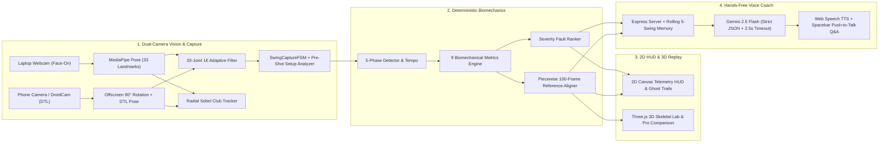

# Golf Swing Coach

> Built for the **Imperial Fintech & Blockchain Society Halloween Hackathon** · Developed by [Hari Narendranath](https://www.linkedin.com/in/hari-narendranath/) & [Sebastian Murray-Baert](https://www.linkedin.com/in/seb-murray-baert/)

An end-to-end, real-time biomechanical golf swing analyzer and conversational voice coach. Using synchronized dual-camera computer vision (**Face-On** laptop webcam + **Down-The-Line** portrait phone stream), deterministic 3D/2D kinematic geometry, interactive **Three.js** skeletal replay, and **Google Gemini 2.5 Flash**, it captures every shot hands-free, diagnoses ranked swing faults in real time, and speaks actionable pre-shot and post-shot coaching cues aloud.


---

## Core Design Principle: *"Code Measures, LLM Talks"*

Large Language Models are notoriously unreliable at raw spatial arithmetic, whereas raw biomechanical numbers (`146° lead arm`, `7.4 cm hip sway`, `2.1:1 tempo`) are difficult for a golfer standing on a mat to translate into a physical feel during practice.

**Golf Swing Coach** strictly separates deterministic biomechanics from natural-language pedagogy:
1. **Deterministic Vision & Kinematics Engine (`src/capture/` & `src/analysis/`):** Extracts 33 2D/3D pose landmarks at up to 60 FPS, filters high-frequency jitter via an adaptive $1\text{€}$ (One Euro) Filter, segments the 5 canonical phases of the swing, computes 9 calibrated biomechanical metrics, and ranks swing faults by normalized severity.
2. **Conversational AI Speech Coach (`src/coaching/` & `server/index.ts`):** Feeds the verified metrics, fault severity rankings, and a 5-swing rolling session memory into **Gemini 2.5 Flash**, which synthesizes a concise, 2-sentence physical drill cue read aloud via Web Speech TTS—and answers hands-free follow-up questions via Spacebar Push-to-Talk.

---

## System Architecture



---

## Key Features

### 1. Synchronized 90° Dual-Camera Studio (Face-On + Down-The-Line)
- **Simultaneous Multi-Angle Tracking:** Runs two independent `PoseTracker` instances concurrently—**Face-On** (landscape laptop webcam) for bilateral rotation, head stability, and lateral sway, and **Down-The-Line (DTL)** (portrait phone via DroidCam/Camo/EpocCam) for spine inclination, knee flex, tush-line depth, and swing plane slot.
- **Lossless Portrait Rotation:** Pre-rotates portrait phone video streams on an offscreen canvas (`±90°`) before MediaPipe inference so upright golfers are tracked with zero aspect-ratio distortion or cropping.
- **Occlusion-Resilient Visibility Gating:** Uses bilateral pair-maximum visibility (`max(left, right)`) so 90° torso rotation at the top of the backswing or self-occlusion in DTL views never drops valid swing frames.

### 2. Hands-Free Swing Capture FSM & Pre-Shot Setup Coach
- **5-State Capture Finite State Machine (`IDLE` → `ADDRESS_HOLD` → `RECORDING` → `FOLLOW_THROUGH` → `DONE`):**
  - Automatically locks address when the golfer holds their hands below hip level (`hands.y >= hips.y - 0.10 * torso`) with low hand velocity (`< 0.65 torso/s`) for `850 ms`, Maintaining a 14-frame rolling pre-roll buffer.
  - Triggers capture completion immediately in the follow-through (`120 ms` finish settle or `240 ms` post-impact window) without requiring the golfer to step back to address.
- **Live Pre-Shot Setup Advice (`setupAnalyzer.ts`):**
  - Evaluates stance width, arm hang, hand centering, trail shoulder tilt, head balance, and DTL spine/knee angles against tour setup benchmarks as soon as address is locked.
  - Speaks **strictly one** concise setup refinement cue per shot and monitors live posture adjustments (`checkSetupCorrectionProgress`), switching the HUD to a green light as soon as the golfer moves $\ge 20\%$ toward the target (or automatically after `2.0 s` so it never nags).
  - Immediately cancels pre-shot TTS the instant takeaway motion begins so the coach never talks over the swing.

### 3. Optional Computer-Vision Golf Club Tracker (`clubTracker.ts`)
- **Works With or Without a Physical Club:** Never blocks capture if swinging empty-handed indoors.
- **Auto CV Mode:** Extracts a $144 \times 144$ pixel region of interest anchored at the MediaPipe wrist/index-knuckle grip midpoint, masks out the forearm and torso angular cones, and casts 72 radial rays ($5^\circ$ steps) using a $3 \times 3$ Sobel gradient operator to lock onto collinear shaft edges and track the clubhead arc.
- **Virtual Club Mode:** Projects a kinematic virtual shaft from the golfer's forearm and wrist vectors for indoor shadow swings.

### 4. Interactive 2D Video Overlays & Three.js 3D Rendering Lab
- **2D Biomechanical HUD (`canvasOverlay.ts`):**
  - Renders a color-coded anatomical skeleton where offending joints glow red/amber based on active faults, alongside a live head stability target box, hip address anchor, spine angle callout badge, and phase-colored hand/clubhead trails (Blue Backswing → Amber Downswing → Red Impact Zone → Emerald Follow-Through).
  - Displays a post-swing phase-jumper pill bar (`Address`, `Takeaway`, `Top`, `Impact`, `Finish`) that freezes the ghost skeleton at any keyframe.
- **Three.js 3D Rendering Lab (`replay3D.ts`):**
  - Full 3D skeletal rig with metallic joints, bone cylinders, torso/pelvis volume meshes, ground contact shadows, and 3D swing-plane ribbons.
  - Side-by-side or superimposed **Tour Pro Reference Ghost** (`ghost` / `split` / `off`), camera presets (`Face-On`, `DTL`, `Overhead`, `Free Orbit`), playback speed controls (`0.25×`, `0.5×`, `1.0×`), and a 100-frame phase-aligned timeline scrubber.

### 5. Gemini 2.5 Flash Voice Coach & Push-to-Talk Q&A
- **Multi-Swing Session Memory:** Tracks `previousFaults`, `previousFocusFault`, and `improved_since_last` across swings. When a golfer fixes their previous focus fault, the coach praises the specific improvement before introducing the next highest-priority fault.
- **Interactive Voice & Text Q&A:** Hold `Spacebar` (or use the text bar) to ask follow-up questions (*"Why is my head moving?"*, *"What drill fixes early extension?"*) grounded in the latest swing telemetry.
- **Zero-Downtime Resilience:** Enforces a strict `2.5s–3.5s` timeout on Gemini API calls and automatically falls back to deterministic, context-aware coaching templates if offline or unconfigured.

---

## Mathematical & Biomechanical Foundations

### 1. Adaptive $1\text{€}$ (One Euro) Low-Pass Filter (`oneEuroFilter.ts`)
A golf swing spans two extreme motion regimes: near-zero velocity at address (where MediaPipe keypoint jitter corrupts spine and head metrics) and high angular velocity during the downswing ($\sim 200\text{–}300\text{ ms}$ from top to impact, where standard low-pass filters introduce severe phase lag).

For each landmark coordinate $x_t$ at timestamp $t$ ($\Delta t = t - t_{t-1}$), we filter the discrete derivative $\dot{x}_t = (x_t - \hat{x}_{t-1}) / \Delta t$ with cutoff $f_{c,\min}^{(d)} = 1.0\text{ Hz}$ and dynamically adapt the position cutoff frequency $f_c$:

$$f_c(t) = f_{c,\min} + \beta \lvert\hat{\dot{x}}_t\rvert, \qquad \alpha(f_c) = \frac{1}{1 + \frac{1}{2\pi f_c \Delta t}}$$

$$\hat{x}_t = \alpha(f_c)\, x_t + \bigl(1 - \alpha(f_c)\bigr)\, \hat{x}_{t-1}$$

With default parameters $f_{c,\min} = 1.2\text{ Hz}$ and $\beta = 0.08$, the filter heavily damps millimeter-scale noise at address ($\hat{\dot{x}}_t \approx 0$) while opening its bandwidth during the downswing so impact positions are never attenuated.

---

### 2. Anthropometric Scale Calibration & Hybrid 2D/3D Coordinate System (`metricsCalculator.ts`)
MediaPipe's 3D `worldLandmarks` re-center the coordinate origin $(0,0,0)$ at the pelvis midpoint on **every frame**, erasing global body translation across time. Conversely, pure 2D image coordinates suffer from perspective foreshortening during axial rotation. We solve both via a hybrid coordinate architecture:

- **Physical Centimetre Calibration (Translation Metrics):**
  At the detected Address frame ($t_{\text{addr}}$), we compute the 2D Euclidean distance between the shoulder midpoint $\mathbf{s}_{\text{addr}}$ and hip midpoint $\mathbf{h}_{\text{addr}}$ and anchor it to a standard adult torso length $L_{\text{torso}} = 50.0\text{ cm}$:

  $$s_{\text{cm}} = \frac{50.0}{\max\bigl(\lVert\mathbf{s}_{\text{addr}} - \mathbf{h}_{\text{addr}}\rVert_2,\, 0.08\bigr)} \quad [\text{cm / normalized unit}]$$

  This converts 2D camera-space displacements (`head_movement_cm`, `hip_sway_cm`, `weight_shift_cm`) into camera-distance-invariant physical centimetres.

- **Blended 2D Foreshortening + 3D World Yaw (Rotational Metrics):**
  Single-camera monocular 3D depth ($z$) estimates can exhibit frame-to-frame variance. To measure axial shoulder turn and hip turn between Address and Top of Backswing, we combine the 3D XZ-plane yaw angle $\theta_{3\text{D}}$ with the 2D horizontal width foreshortening ratio $\Delta x_{\text{top}} / \Delta x_{\text{addr}}$:

  $$\theta_{3\text{D}} = \arccos\!\left(\frac{\mathbf{v}_{\text{addr}}^{(xz)} \cdot \mathbf{v}_{\text{top}}^{(xz)}}{\lVert\mathbf{v}_{\text{addr}}^{(xz)}\rVert\,\lVert\mathbf{v}_{\text{top}}^{(xz)}\rVert}\right), \qquad \theta_{2\text{D}} = \arccos\!\left(\text{clamp}\!\left(\frac{\Delta x_{\text{top}}}{\Delta x_{\text{addr}}}, -0.25, 1.0\right)\right)$$

  $$\theta_{\text{turn}} = 0.65\,\theta_{2\text{D}} + 0.35\,\theta_{3\text{D}}$$

  **X-Factor** (thoracic-pelvic separation at the top of the backswing) is then constrained biomechanically so hip turn cannot exceed shoulder turn:

  $$\theta_{\text{X-Factor}} = \max\bigl(0,\, \theta_{\text{shoulder}} - \min(\theta_{\text{hip}},\, \theta_{\text{shoulder}} - 5^\circ)\bigr)$$

---

### 3. 5-Phase Kinematic Segmentation (`phaseDetector.ts`)
Given a captured sequence of $n$ frames, `detectSwingPhases` enforces strict monotonic ordering ($t_{\text{address}} \le t_{\text{takeaway}} < t_{\text{top}} < t_{\text{impact}} \le t_{\text{finish}}$):

1. **Downswing Peak Velocity ($i_{\text{peak}}$):** Identifies the global maximum of torso-normalized 3-frame smoothed hand speed $v(i) = \lVert\mathbf{p}_i - \mathbf{p}_{i-1}\rVert_2 / (L_{\text{torso}} \cdot \Delta t_i)$.
2. **Top of Backswing ($i_{\text{top}}$):** Searches prior to $i_{\text{peak}}$ for the hand apex ($\min y_i$), then refines within a $\pm 6\%$ temporal window to find the local velocity minimum $\arg\min_i v(i)$ corresponding to the transition pause where the club reverses direction.
3. **Takeaway ($i_{\text{takeaway}}$) & Address ($i_{\text{address}}$):** Walks backward from $i_{\text{top}}$ until both hand speed and displacement from the initial setup anchor fall below threshold ($v_i < \max(0.45, 0.14 v_{\max})$ and $\lVert\mathbf{p}_i - \mathbf{p}_0\rVert_2 < 0.12 L_{\text{torso}}$).
4. **Impact ($i_{\text{impact}}$):** Maximizes a composite objective combining normalized downswing speed and Gaussian spatial proximity to the address hand coordinates $(x_{\text{addr}}, y_{\text{addr}})$:

   $$S_{\text{impact}}(i) = 0.55\,\frac{v(i)}{v_{\max,\text{down}}} + 0.45\,\exp\!\left(-2.5\left[\left(\frac{y_i - y_{\text{addr}}}{L_{\text{torso}}}\right)^2 + 0.5\left(\frac{x_i - x_{\text{addr}}}{L_{\text{torso}}}\right)^2\right]\right)$$

5. **Finish ($i_{\text{finish}}$):** Maximizes lead-side hand elevation above the shoulders plus a stillness bonus $1 / (1 + v(i))$.

---

### 4. The 9 Biomechanical Metrics & Severity Fault Ranking

| # | Metric Key | Biomechanical Definition | Tour Target | Fault Triggered & Severity Formula |
| :- | :--- | :--- | :--- | :--- |
| **1** | `tempo_ratio` | $\dfrac{t_{\text{top}} - t_{\text{takeaway}}}{t_{\text{impact}} - t_{\text{top}}}$ | $\approx 3.0 : 1$ (`2.5–3.5`) | `fast_tempo` ($<2.3$, $\frac{2.5 - r}{0.6}$) / `slow_tempo` ($>3.8$, $\frac{r - 3.6}{0.8}$) |
| **2** | `lead_arm_deg` | Interior elbow angle $0.6\theta_{2\text{D}} + 0.4\theta_{3\text{D}}$ at Top | $> 160^\circ$ | `bent_lead_arm` ($<155^\circ$, $\frac{160 - \theta}{15}$) |
| **3** | `shoulder_turn_deg` | Axial ribcage rotation from Address to Top | $80^\circ\text{–}90^\circ$ | `poor_shoulder_turn` ($<65^\circ$, $\frac{75 - \theta}{18}$) |
| **4** | `hip_turn_deg` | Axial pelvis rotation from Address to Top | $40^\circ\text{–}50^\circ$ | Evaluated via X-Factor & sway coupling |
| **5** | `x_factor_deg` | $\theta_{\text{shoulder}} - \theta_{\text{hip}}$ coil at Top | $35^\circ\text{–}45^\circ$ | `low_x_factor` ($<25^\circ$, $\frac{32 - \theta}{12}$) |
| **6** | `spine_angle_change_deg` | $\Delta\theta_{\text{spine}} = \lvert\theta_{\text{spine}}(t_{\text{impact}}) - \theta_{\text{spine}}(t_{\text{addr}})\rvert$ | $< 5.0^\circ$ | `early_extension` ($>5.5^\circ$, $\frac{\Delta\theta - 5.0}{4.0}$) |
| **7** | `head_movement_cm` | $\max_{t \in [\text{addr}, \text{impact}]} \lVert\mathbf{n}_t - \mathbf{n}_{\text{addr}}\rVert_2 \cdot s_{\text{cm}}$ | $< 5.0\text{ cm}$ | `head_movement` ($>5.5\text{ cm}$, $\frac{d - 5.0}{4.0}$) |
| **8** | `hip_sway_cm` | Max trail-ward pelvis shift during backswing | $< 5.0\text{ cm}$ | `hip_sway` ($>5.0\text{ cm}$, $\frac{d - 5.0}{4.0}$) |
| **9** | `weight_shift_cm` | Lead-ward pelvis transfer toward target at Impact | $\ge 3.0\text{ cm}$ | `no_weight_shift` ($<1.5\text{ cm}$, $\frac{2.5 - d}{2.0}$) |

---

### 5. Piecewise Phase Alignment & Reference Similarity Scoring (`referenceAligner.ts`)
To compare swings of different durations and body proportions against a saved reference swing (`data/reference.json`):
1. **Torso-Centered Spatial Normalization:** Every frame's 33 3D landmarks $\mathbf{p}_j$ are translated so the hip midpoint sits at $(0,0,0)$ and scaled by 3D torso length $\lVert\mathbf{s} - \mathbf{h}\rVert_2 = 1.0$.
2. **Piecewise Phase Resampling ($N = 100$ Canonical Frames):** Instead of uniform linear time warping (which misaligns impact when two golfers have different backswing-to-downswing ratios), we resample each phase segment independently:
   - Frames $0\text{–}49$ ($50$ frames): $\text{Address} \to \text{Top}$
   - Frames $50\text{–}74$ ($25$ frames): $\text{Top} \to \text{Impact}$
   - Frames $75\text{–}99$ ($25$ frames): $\text{Impact} \to \text{Finish}$
3. **Exponential Similarity Mapping:** Across 10 key golf joints $\mathcal{J}$ (bilateral shoulders, elbows, wrists, hips, knees), we compute the anisotropic Euclidean error (weighting $z$-depth at $0.5\times$ to account for monocular depth variance) and blend it with the deterministic metric score $S_{\text{metrics}}$:

   $$\bar{E} = \frac{1}{100\,\lvert\mathcal{J}\rvert} \sum_{f=0}^{99} \sum_{j \in \mathcal{J}} \sqrt{(u_{f,j}^x - r_{f,j}^x)^2 + (u_{f,j}^y - r_{f,j}^y)^2 + 0.25\,(u_{f,j}^z - r_{f,j}^z)^2}$$

   $$S_{\text{align}} = 100 \cdot \exp(-1.5\,\bar{E}), \qquad S_{\text{match}} = \text{round}\bigl(0.55\,S_{\text{align}} + 0.45\,S_{\text{metrics}}\bigr)$$

---

### 6. Radial Sobel Collinearity Club Detection (`clubTracker.ts`)
To detect a thin golf shaft at high speed without requiring hardware sensors or fiducial markers:
1. For each candidate ray angle $\theta \in [-\pi, \pi)$ (excluding angles within $\pm 30^\circ$ of the golfer's forearms and torso), we sample pixels $(p_x, p_y) = (x_{\text{grip}} + r\cos\theta,\, y_{\text{grip}} + r\sin\theta)$ for $r \in [15, 68]\text{ px}$.
2. Using a $3 \times 3$ Sobel operator $(G_x, G_y)$, a genuine shaft along unit vector $\mathbf{u}(\theta) = (\cos\theta, \sin\theta)$ produces strong gradients **orthogonal** to the ray. We measure the normalized parallel component:

   $$c_{\parallel}(r, \theta) = \frac{\lvert G_x \cos\theta + G_y \sin\theta\rvert}{\sqrt{G_x^2 + G_y^2}}$$

3. Rays with $\lvert\nabla I\rvert > 42$ and $c_{\parallel} < 0.36$ accumulate perpendicular edge strength, weighted by collinear sample ratio and a temporal continuity prior ($1.14\times$ within $\pm 24^\circ$ of the previous frame's shaft angle).

---

## Project Structure

```text
golf-swing-coach/
├── index.html                       # Studio UI layout (Live Camera Studio, 3D Lab, AI Coach & Metrics)
├── package.json                     # Scripts & dependencies (Three.js, MediaPipe, Gemini, Express, Vite)
├── tsconfig.json                    # Strict ES2022 TypeScript configuration
├── vite.config.ts                   # Vite dev server + /api proxy to Express port 3001
├── server/
│   └── index.ts                     # Express backend: Gemini 2.5 Flash coach/Q&A + JSON swing storage
├── src/
│   ├── main.ts                      # Application orchestrator: dual streams, FSM hooks, UI bindings
│   ├── style.css                    # High-contrast dark telemetry UI styling
│   ├── types.ts                     # Shared TypeScript interfaces & MediaPipe landmark indices
│   ├── capture/
│   │   ├── cameraManager.ts         # Multi-stream WebRTC camera & video file manager + FPS meter
│   │   ├── poseTracker.ts           # Dual MediaPipe PoseLandmarker wrapper + DTL side-profile metrics
│   │   ├── oneEuroFilter.ts         # 1D, 3D, and 33-landmark bank of adaptive 1€ low-pass filters
│   │   ├── clubTracker.ts           # Radial Sobel edge-collinearity & virtual golf club tracker
│   │   └── swingCaptureFSM.ts       # 5-state hands-free swing capture finite state machine + Web Audio cues
│   ├── analysis/
│   │   ├── phaseDetector.ts         # 5-phase kinematic segmentation (Address, Takeaway, Top, Impact, Finish)
│   │   ├── metricsCalculator.ts     # Deterministic 9 biomechanical metrics & severity fault ranker
│   │   ├── setupAnalyzer.ts         # Pre-shot address posture analyzer & live 20% correction tracker
│   │   └── referenceAligner.ts      # Torso normalization + 100-frame piecewise phase alignment & scoring
│   ├── visuals/
│   │   ├── canvasOverlay.ts         # 2D biomechanical skeleton, fault highlights, trails & phase jumper
│   │   └── replay3D.ts              # Three.js 3D skeletal replay viewer, pro ghost comparison & scrubber
│   └── coaching/
│       └── speechCoach.ts           # Web Speech API TTS, Spacebar Push-to-Talk STT, and mock scenarios
├── data/
│   ├── reference.json               # Saved reference swing for 2D/3D Pro comparison
│   └── swings/                      # Auto-persisted SwingRecording JSON files (swing-<timestamp>.json)
└── docs/
    ├── IMPLEMENTATION_PLAN.md       # Deep-dive technical specification
    └── HACKATHON_PLAN.md            # Hackathon architecture & track breakdown
```

---

## Tech Stack

| Layer | Technology | Purpose |
| :--- | :--- | :--- |
| **Frontend & Bundler** | TypeScript 5.5, Vite 5.4, HTML5 / CSS3 | Zero-overhead reactive DOM updates & 60 FPS canvas loop |
| **Computer Vision** | `@mediapipe/tasks-vision` (`PoseLandmarker`) | Real-time 33-joint 2D normalized & 3D metric pose estimation |
| **Signal Processing** | Custom $1\text{€}$ Filter + Sobel Ray-Casting | Adaptive pose smoothing & markerless golf club shaft tracking |
| **2D & 3D Graphics** | HTML5 2D Canvas + `three` (Three.js r168) | Live telemetry HUD, ghost trails, and interactive 3D skeletal replay |
| **Voice I/O** | Web Speech API (`speechSynthesis` & `SpeechRecognition`) | Zero-cost browser TTS coaching & Spacebar Push-to-Talk voice Q&A |
| **AI Coaching Backend** | Node.js, Express, `@google/generative-ai` (`gemini-2.5-flash`) | Structured JSON coaching cues, 5-swing session memory & live Q&A |

---

## Getting Started

### Prerequisites
- **Node.js** `v18+` (recommended `v20+` or `v22+`)
- A **Google Gemini API Key** ([Get one from Google AI Studio](https://aistudio.google.com/)) — *optional: the app includes a full deterministic fallback coach if run without a key.*
- **Webcam** (and optionally a smartphone running **DroidCam**, **Camo**, or **EpocCam** for the 90° Down-The-Line view).

### Installation & Running Locally

1. **Clone the repository and install dependencies:**
   ```bash
   git clone https://github.com/HNarendranath/golf-swing-coach.git
   cd golf-swing-coach
   npm install
   ```

2. **Configure your environment variables:**
   Create a `.env` file in the project root (or copy `.env.example`):
   ```env
   GEMINI_API_KEY=your_gemini_api_key_here
   PORT=3001
   ```
   *(Note: The Express server reloads `.env` dynamically on every request, so you can paste your key at any time without restarting the server.)*

3. **Start the full-stack development server (Vite + Express):**
   ```bash
   npm run dev
   ```
   - **Frontend Studio:** `http://localhost:5173`
   - **Backend Coaching & Persistence API:** `http://localhost:3001`

4. **Production Build & Typecheck:**
   ```bash
   npm run build
   ```

---

## REST API Reference (`server/index.ts`)

| Method | Endpoint | Description |
| :--- | :--- | :--- |
| `GET` | `/api/health` | Returns server status, whether `GEMINI_API_KEY` is configured, and active session history count. |
| `POST` | `/api/coach` | Accepts a `CoachingPayload` (metrics, ranked faults, improved faults) and returns `{ spoken, fault, drill, latencyMs, source }`. |
| `POST` | `/api/qa` | Accepts `{ question, latest_swing }` from Push-to-Talk STT or text input and returns a grounded spoken answer. |
| `POST` | `/api/coach/reset` | Clears the 5-swing rolling session memory on the backend. |
| `GET` / `POST` | `/api/reference` | Loads or saves the canonical reference swing (`data/reference.json`) for 2D/3D pro comparison. |
| `GET` / `POST` | `/api/swings` | Lists recent swings or persists a new `SwingRecording` JSON to `data/swings/swing-<timestamp>.json`. |
| `GET` | `/api/swings/:id` | Retrieves a specific recorded swing JSON by ID. |
