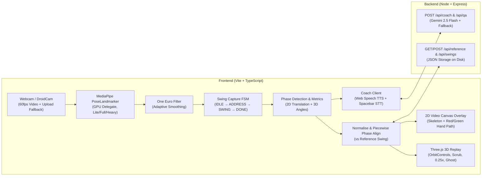

# Golf Swing Coach — Implementation Plan

## Goal Description
Build a real-time **Golf Swing Coach** web application with a lightweight Node/Express backend and a Vite + TypeScript frontend. The app captures swings from a webcam/DroidCam feed using **MediaPipe Pose Landmarker**, automatically detects swing phases, calculates biomechanical metrics (fixing the 2D vs. 3D coordinate system pitfalls), compares and time-aligns the user's swing against a reference swing, renders a **2D ghost path overlay** and an interactive **Three.js 3D skeleton replay**, and delivers live spoken coaching and voice Q&A powered by **Gemini (`gemini-2.5-flash`)** and the **Web Speech API**.

---

## Architecture Overview



---

## Key Technical Mitigations Built Into the Design

> [!IMPORTANT]
> **Coordinate System Fix (2D vs. 3D World Landmarks)**
> MediaPipe's `worldLandmarks` re-centers `(0, 0, 0)` at the hip midpoint on *every single frame*. Therefore:
> - **Translation metrics** (**Head Movement**, **Hip Sway**, **Weight Shift**) are computed from normalized **2D image `landmarks`** anchored to the **Address frame's hip midpoint**, converted to centimetres using the golfer's 2D torso length (`shoulder_mid ↔ hip_mid` = 50 cm reference).
> - **Angular/rotational metrics** (**Lead Arm Angle**, **Spine Angle**, **Shoulder Turn**, **Hip Turn**, **X-Factor**) use **3D `worldLandmarks`** blended with 2D shoulder-width foreshortening ($\arccos(W_{\text{top}} / W_{\text{address}})$) so single-camera $Z$ noise never produces wild rotation numbers.

> [!TIP]
> **Demo Reliability & Fallbacks**
> - **Bundled Reference Swing:** Includes a realistic pre-computed `reference.json` out of the box, plus a **"Set Last Swing as Reference"** button so you can record your best take live.
> - **Capture Override:** Auto-detects address stillness and finish, with an audio beep on address lock, a 1.0s post-impact auto-stop fallback, AND a manual **Force Start/Stop** button for testing in tight spaces.
> - **Offline/Timeout Coaching Fallback:** If Gemini takes >2.5s or Wi-Fi drops, deterministic coaching templates fire immediately so TTS never stalls during the demo.

---

## Folder & File Structure

```text
golf-swing-coach/
├── docs/
│   ├── HACKATHON_PLAN.md        # Original 5-hour hackathon brief & specs
│   └── IMPLEMENTATION_PLAN.md   # Technical architecture & implementation plan
├── server/
│   └── index.ts                 # Express backend (Gemini API + swing JSON persistence)
├── src/
│   ├── main.ts                  # Frontend entry point & UI orchestration
│   ├── style.css                # Dashboard styles
│   ├── types.ts                 # Shared TypeScript interfaces
│   ├── capture/
│   │   ├── oneEuroFilter.ts     # Adaptive low-pass filter for landmarks
│   │   ├── poseTracker.ts       # MediaPipe PoseLandmarker wrapper
│   │   └── swingCaptureFSM.ts   # Address → Swing → Finish state machine
│   ├── analysis/
│   │   ├── phaseDetector.ts     # Address, Takeaway, Top, Impact, Finish detection
│   │   ├── metricsCalculator.ts # 9 biomechanical metrics & fault ranking
│   │   └── referenceAligner.ts  # Normalization, piecewise phase alignment & match score
│   ├── visuals/
│   │   ├── canvasOverlay.ts     # 2D video skeleton & ghost hand path overlay
│   │   └── replay3D.ts          # Three.js 3D skeleton & OrbitControls replay
│   └── coaching/
│       └── speechCoach.ts       # Web Speech API (TTS + Spacebar push-to-talk STT)
├── data/
│   ├── reference.json           # Saved reference swing
│   └── swings/                  # Recorded user swings
├── index.html                   # App shell
├── package.json
├── tsconfig.json
├── vite.config.ts
└── .env.example
```

---

## Component Breakdown

### 1. Project Setup & Backend (`server/`)
- `GET /api/reference` & `POST /api/reference`: Reads/writes `data/reference.json`.
- `POST /api/swings` & `GET /api/swings`: Saves captured swings (`data/swings/swing-<timestamp>.json`) and lists history.
- `POST /api/coach`: Accepts structured swing metrics payload, maintains rolling session context (last 5 swings), calls **Gemini (`gemini-2.5-flash`)** with structured JSON output (`{ spoken, fault, drill }`) and 4 few-shot examples, and falls back to deterministic lines on timeout/error.
- `POST /api/qa`: Handles push-to-talk voice questions (`{ question, latestMetrics, history }`) and returns a concise <=3-sentence spoken answer.

### 2. Core Capture, Smoothing & Phase Detection (`src/capture/`)
- **`src/types.ts`**: Shared interfaces (`Landmark`, `SwingFrame`, `SwingRecording`, `SwingPhases`, `SwingMetrics`, `SwingFault`, `CoachingPayload`, `CoachingResponse`, `Handedness`).
- **`src/capture/oneEuroFilter.ts`**: 3D/2D `OneEuroFilter` implementation per landmark coordinate (`minCutoff = 1.2`, `beta = 0.08`, `dCutoff = 1.0`).
- **`src/capture/poseTracker.ts`**: Initializes MediaPipe `PoseLandmarker` (`lite`, `full` default, `heavy` selectable in UI) with `GPU` delegate.
- **`src/capture/swingCaptureFSM.ts`**: State machine (`IDLE → ADDRESS_HOLD → RECORDING → FOLLOW_THROUGH → DONE`).

### 3. Phase Detection, Biomechanical Metrics & Reference Alignment (`src/analysis/`)
- **`src/analysis/phaseDetector.ts`**: Detects `address`, `takeaway`, `top`, `impact`, and `finish` frame indices and timestamps.
- **`src/analysis/metricsCalculator.ts`**: Computes Tempo Ratio, Head Movement (cm), Hip Sway (cm), Weight Shift (cm), Shoulder Turn (deg), Hip Turn (deg), X-Factor (deg), Lead Arm Angle (deg), and Spine Angle Change (deg), with right/left-handed awareness.
- **`src/analysis/referenceAligner.ts`**: Normalizes swings by hip midpoint and torso length, piecewise linearly resamples phases, and computes the `0–100` Swing Match Score.

### 4. Visuals: 2D Video Overlay & 3D Three.js Replay (`src/visuals/`)
- **`src/visuals/canvasOverlay.ts`**: Draws live skeleton, address box, and Reference (Green) vs. User (Red) hand paths.
- **`src/visuals/replay3D.ts`**: Three.js scene with `OrbitControls`, joint spheres, bone lines (`POSE_CONNECTIONS`), `0.25x` slow-mo, phase scrubber, and toggleable reference ghost skeleton.

### 5. Speech Coaching & Dashboard UI (`src/coaching/` & `src/main.ts`)
- **`src/coaching/speechCoach.ts`**: Web Speech API `speechSynthesis` (TTS) and push-to-talk `SpeechRecognition` (STT via Spacebar).

